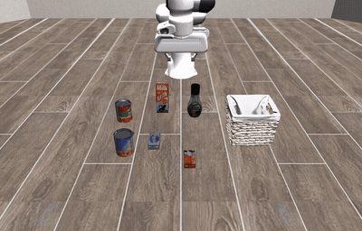
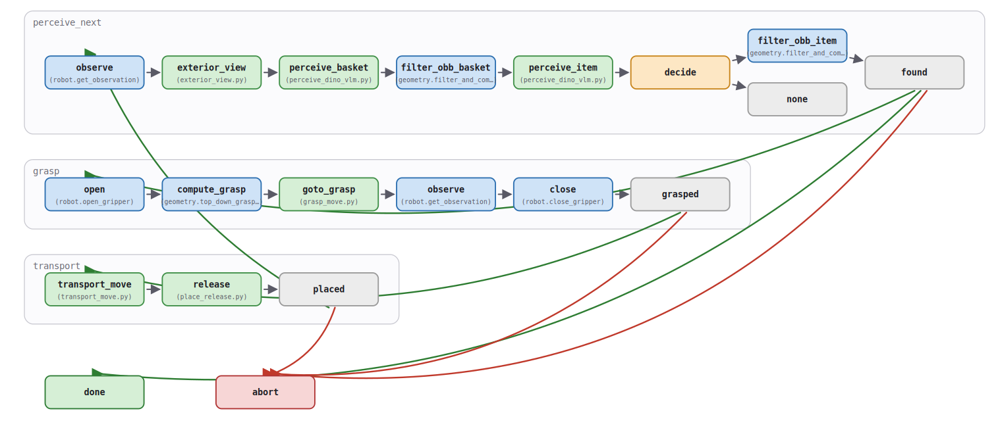
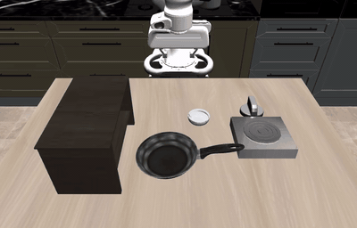
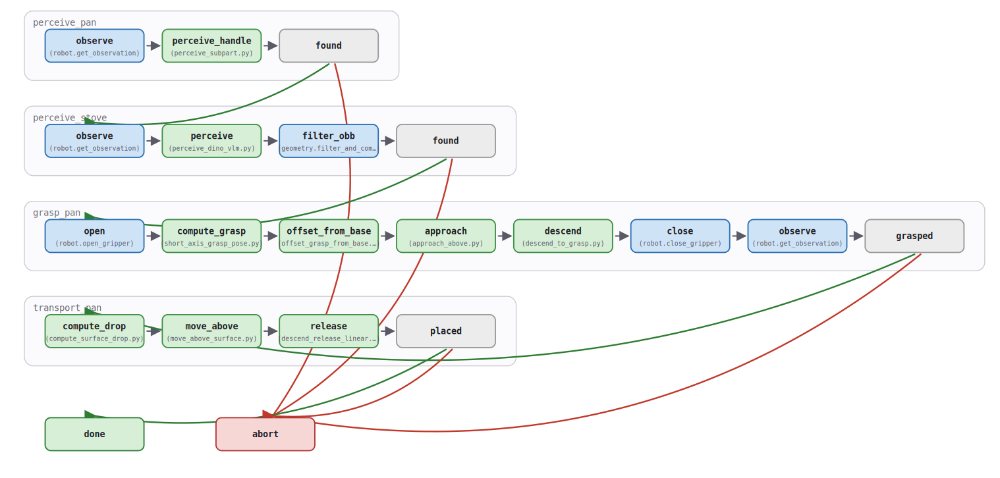

# Graph-as-Policy

This Ryzer runs
[Graph-as-Policy](https://github.com/graph-robots/graph-as-policy) with
LIBERO, LIBERO-PRO, VAB, open-robot-skills, and PyRoKI motion. Grounding DINO
and SAM3 use ROCm PyTorch; hosted VLM queries use OpenRouter. MuJoCo renders
through EGL, while geometry and PyRoKI use the CPU.

## Build and check the image

Export credentials on the host. `HF_TOKEN` needs read access to
[`facebook/sam3`](https://huggingface.co/facebook/sam3). OpenRouter supplies
the VLM calls used by the perception skills and the LLM calls used by graph
generation.

```bash
# Not needed for build or gap check; needed for generation and perception
export HF_TOKEN=hf_...
export OPENROUTER_API_KEY=sk-or-v1-...

ryzers build gap
ryzers run
```

The default command checks the installed dependency graph, upstream runtime
and connector IK tests, GPU access, EGL rendering, a real PyRoKI Cartesian
plan, tool-bundle startup, VAB and LIBERO-PRO environment steps, and graph
validation. It does not download model weights.

Open a shell for full workflows:

```bash
ryzers run bash
cd /ryzers/graph-as-policy
gap check
```

`config.yaml` passes the two exported variables into the container without
storing their values. The first perception run downloads model weights into
the mounted Hugging Face cache.

## Run an existing graph

The upstream quickstart detects a soup can, grasps it, and places it in a
basket:

```bash
gap run examples/libero_quickstart/graph \
  --sim libero_object_all_variance/0
```

To check graph structure and required tools without moving the simulated
robot:

```bash
gap run examples/libero_quickstart/graph \
  --sim libero_object_all_variance/0 \
  --validate-only
```

### Grocery packing

The image also contains
`examples/grocery_packing_pyroki/packing_graph`, a PyRoKI variant of the pinned
upstream workflow. Because the graph is already authored, validation does not
use graph-generation credentials:

```bash
gap run examples/grocery_packing_pyroki/packing_graph \
  --sim libero_object_packing/0 \
  --validate-only
```

Run the workflow:

```bash
gap run examples/grocery_packing_pyroki/packing_graph \
  --sim libero_object_packing/0
```

The full rollout does not call the graph-generation API. Perception still
requires SAM3 weights and either a local VLM or the configured hosted VLM.

The graph prefers straight Cartesian segments, with an unconstrained IK
fallback for some transport moves. It has no collision-aware planner.

<p align="center">
  
  
  <br>
  <em>Grocery-packing rollout (left, reward 1.0) and workflow graph
  (right).</em>
</p>

Simulation runs record an MP4 and a node-by-node trace under
`outputs/run_<timestamp>/`. The directory is mounted at
`packages/robotics/gap/outputs` on the host.

## Generate and run a graph

`gap generate` asks the coding-agent pipeline to write a typed workflow,
scripts, and checkpoints:

```bash
gap generate "put the frying pan on the stove" \
  --provider openrouter \
  --model google/gemini-3.1-pro-preview \
  --out outputs/pan_graph

gap run outputs/pan_graph/task_00 --validate-only
gap run outputs/pan_graph/task_00 \
  --sim libero_popcorn_production/0
```

Inspect the generated tool requirements, scripts, and checkpoints before
execution. Structural validation does not prove that the selected connector
implements every tool or that the task will earn simulator reward. Treat the
`reward` and `success` values printed after a rollout as the acceptance result.

<p align="center">
  
  
  <br>
  <em>Pan-on-stove subtask: rollout
  (left, reward 1.0) and graph (right).</em>
</p>

## Inspect a run

```bash
gap viz --no-browser
```

Open <http://localhost:9432>. The server binds to localhost by default.

## References

- [Graph-as-Policy](https://github.com/graph-robots/graph-as-policy)
- [open-robot-skills](https://github.com/graph-robots/open-robot-skills)
- [GaP installation guide](https://graph-robots.github.io/graph-as-policy/getting-started/installation.html)

Copyright(C) 2026 Advanced Micro Devices, Inc. All rights reserved.
